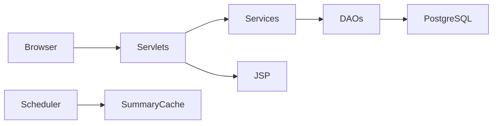

Live Link--->'https://employee-performance-management-system-b6x9.onrender.com'

# Employee Performance Management System

EPMS is a Java 17 MVC web application for employee goals, review cycles, authentication, and performance reporting.

## Technology and architecture

Java 17, Maven WAR, Servlet 4.0/JSP/JSTL on Tomcat 9, PostgreSQL via JDBC and HikariCP, BCrypt, Bootstrap 5, Chart.js, and `java.util.logging`.



Roles are represented by `Admin`, `Manager`, and `Employee`, all extending the abstract `User`. Configuration uses `DATABASE_URL` from Neon, or the `DB_URL`, `DB_USER`, and `DB_PASSWORD` fallback, plus `PORT`. The pooled Neon URL is parsed by `DBConnection` and used with HikariCP.

## Local setup

Install Java 17, Maven, PostgreSQL, and Tomcat 9. Set the environment variables, then run:

```bash
mvn clean package
```

Deploy `target/epms.war` to Tomcat 9, or build with `docker build -t epms .` and run with the environment variables above.

## Deployment

Create a Neon PostgreSQL database using a JDBC URL ending in `?sslmode=require`, configure the same variables in Render, and deploy the Dockerfile. The `/health` endpoint returns `OK`.

Demo accounts:

| Role | Email | Password |
|---|---|---|
| Admin | `admin@epms.com` | `Admin@123` |
| Manager | `manager@epms.com` | `Manager@123` |
| Manager 2 | `manager2@epms.com` | `Manager@123` |
| Employee | `employee@epms.com` | `Employee@123` |
| Employees 2-5 | `employee2@epms.com` through `employee5@epms.com` | `Employee@123` |

The demo rows are defined in `src/main/resources/demo-seed.sql` and can be applied to a configured database after the schema is created.

## Core Java rubric map

| Concept | Implementation |
|---|---|
| Abstraction/inheritance/polymorphism | `com.epms.model.User` and role subclasses |
| Interfaces/generics | `GenericDAO<T, ID>`, `Reportable`, `Result<T>`, `Pair<K,V>` |
| JDBC and transactions | `DBConnection`, `JdbcUserDAO`, `ReviewService` |
| Collections/streams | `ReportService` |
| Multithreading | `ReportScheduler`, `SummaryCache` |
| Servlet integration | `com.epms.controller` and filters |

See [docs/architecture.mmd](docs/architecture.mmd) and [docs/er-diagram.mmd](docs/er-diagram.mmd).

## Product walkthrough and role workflows

The stakeholder presentation [EPMS-Product-Walkthrough.pptx](EPMS-Product-Walkthrough.pptx)
contains authenticated screenshots captured from the local application for the Admin,
Manager, and Employee roles. The source screenshots are stored in [docs/](docs/).

### Admin workflow

1. Sign in with an administrator account.
2. Create and search employees, assigning each person to a department and manager.
3. Create a review cycle, such as `Q4 2026`, and close it when the review period ends.
4. Open Reports to review department averages, rating distribution, top performers, and CSV export.

### Manager workflow

1. Sign in with a manager account.
2. Open Team Goals to review employee objectives, weights, due dates, and progress.
3. Open Team Reviews to submit a 1-5 rating with comments, strengths, and improvement areas.
4. Use Reports to identify coaching opportunities and recognize high performance.

### Employee workflow

1. Sign in with an employee account.
2. Open My Goals to review assigned objectives and update progress from 0 to 100 percent.
3. Open Reviews to read manager feedback and complete self-assessment activities.
4. Open Notifications to review system updates and review reminders.

### End-to-end performance cycle

```text
Admin setup → Manager assigns goals → Employee updates progress
→ Manager submits review → Reports summarize organizational performance
```

The current UI includes responsive navigation, active-page highlighting, searchable lists,
progress bars, status badges, empty states, print-friendly reports, CSV export, confirmation
prompts for closing cycles, and a persisted light/dark theme preference.

### Demo evidence

The screenshots used in the presentation were captured from the local Tomcat deployment:

| Role | Screenshots |
|---|---|
| Admin | [Dashboard](docs/admin-dashboard.png), [Employees](docs/admin-employees.png), [Reports](docs/admin-reports.png) |
| Manager | [Dashboard](docs/manager-dashboard.png), [Goals](docs/manager-goals.png), [Reviews](docs/manager-reviews.png) |
| Employee | [Dashboard](docs/employee-dashboard.png), [Goals](docs/employee-goals.png), [Notifications](docs/employee-notifications.png) |

To regenerate the presentation after capturing new screenshots:

```bash
npm install --no-save pptxgenjs
node scripts/create-presentation.js
```

